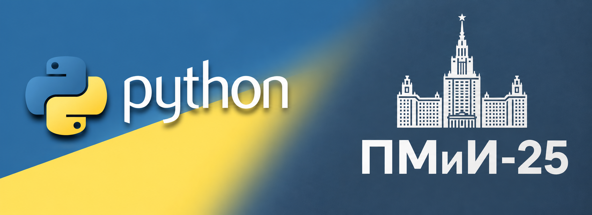

# GENERAL

Welcome! This repository are my personal files storage for python lession.\
**The lecture(teacher):**\
**The period:** 23.11.2026 -- 06.12.2026\
**The lecture repository:** [TashPyCourse](https://github.com/frogorot/TashPyCourse/)\

## CONTENT
```text
python_lession/
├── src/
│   ├── tasks
│		├── lessions
│   └── project
└── docs/
```
**SRC** - BLABLA.
 - **tasks directory** -- folders for task.
 - **lessions directory** -- storage files that create in lessions.
 - **project file** -- my project work.


**DOCS** - README, pictures for README and etc.


## THE PROJECT
The task is generate antena, that pass the test. BLABLA

## THE WORKING FLOW
Simply push commit in master branch. :/\
The repository have single contributor(Yeah, that me) to allow me choiche that working flow.


